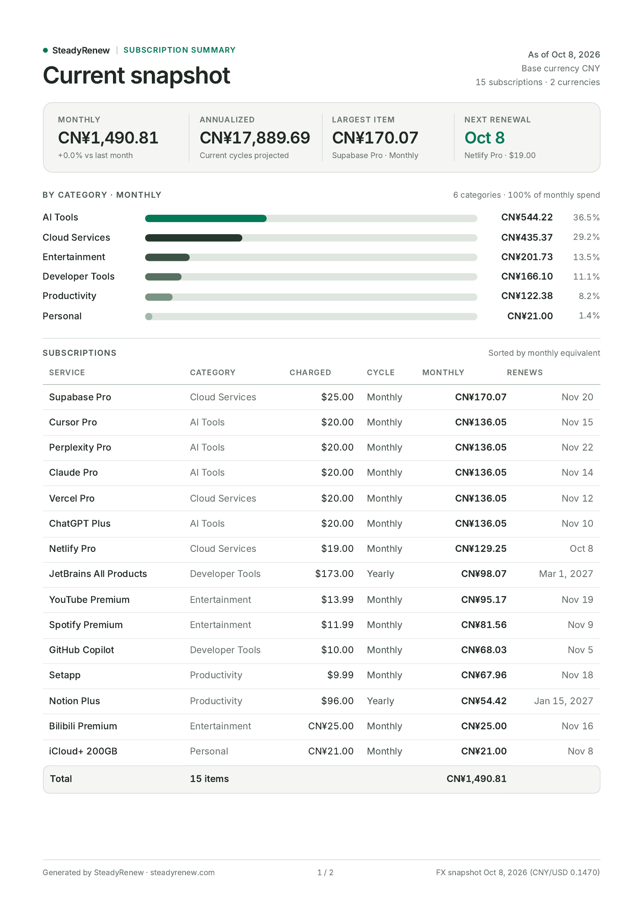
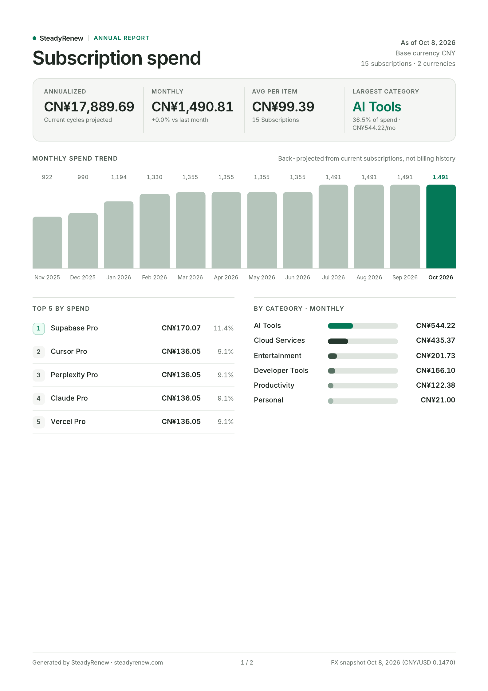

# SteadyRenew

[English](README.md) | [简体中文](README.zh-CN.md)

Use online: [steadyrenew.com](https://steadyrenew.com) · App: [steadyrenew.com/app](https://steadyrenew.com/app) · Docs: [steadyrenew.com/docs](https://steadyrenew.com/docs)

SteadyRenew is a local-first web app for tracking recurring subscriptions and free trials without linking your bank. It supports multi-currency totals, Bark push reminders, AI-assisted capture, print-ready A4 PDF reports, optional cloud sync, and Developer API & MCP integrations.

The app works without an account by storing data in the browser. Supabase, Stripe, Netlify Functions, and Bark notifications can be configured when you want hosted sync, Passkey sign-in, Lifetime Premium checkout, server-side reminders, or API/MCP automation.

https://github.com/user-attachments/assets/a7bb1549-0076-4aa8-a8d8-4a6d5ba0e17c

<p align="center"><em>Add a subscription with AI Assist — type a sentence, review the draft, apply.</em></p>

https://github.com/user-attachments/assets/08f934dc-0460-4085-a0ba-f2d5193de3d1

<p align="center"><em>Add a subscription manually — fill in the form, save, and see it appear.</em></p>

<p align="center">
  <a href="docs-site/images/product/pdf-report-snapshot.png"></a>
  <a href="docs-site/images/product/pdf-report-annual.png"></a>
</p>

<p align="center"><em>Print-ready A4 PDF reports: current snapshot and annual spend (sample data).</em></p>

## Features

- Track recurring subscriptions and one-shot free trials with category, amount, currency, billing period, and renewal date
- View monthly and yearly totals in a selected base currency
- Convert between CNY, USD, EUR, JPY, GBP, AUD, CAD, CHF, HKD, and SGD
- Sort and filter subscriptions by name, amount, renewal date, category, status, or creation date
- Manage built-in and custom categories
- Use AI capture to propose creates, updates, deletes, and batch updates from text or screenshots
- Import and export subscription data as JSON
- Review spending reports, category breakdowns, top subscriptions, and renewal patterns
- Export client-side print-ready A4 PDF reports (current snapshot and annual spend)
- Use optional Supabase authentication (email/password, OAuth, and Passkeys) and multi-device sync
- Send optional Bark push reminders for upcoming renewals and free-trial endings
- Connect AI assistants via hosted Streamable HTTP MCP (`/api/mcp`), single-file local stdio MCP (`/downloads/steadyrenew-mcp.mjs`), or the `/api/v1/*` REST API
- Use light or dark mode on desktop and mobile

## Tech Stack

- React 18 & TypeScript
- Vite & Tailwind CSS
- i18next & Recharts
- Supabase (Auth, Postgres + RLS, WebAuthn Passkeys)
- Netlify Edge Functions & Serverless/Scheduled Functions
- Model Context Protocol (`@modelcontextprotocol/sdk`)
- Stripe Checkout & Webhooks

## Getting Started

### Requirements

- Node.js 22.12 or newer
- npm

### Run Locally

```bash
git clone https://github.com/JerryyrreJ/subscription-management.git
cd subscription-management
npm install
npm run dev
```

The Vite development server runs at `http://localhost:5173` (`/app` opens the tracker).

To test Netlify Functions locally (`/api/v1/*`, `/api/mcp`, AI capture, Stripe, or scheduled notifications), use:

```bash
npm run dev:full
```

This command requires the Netlify CLI.

## Scripts

```bash
npm run dev                 # Start the Vite development server
npm run dev:full            # Start Netlify local development (frontend + Functions)
npm run build               # Build frontend, agent/MCP assets, and prerendered pages
npm run preview             # Preview the production build
npm run indexnow            # Submit sitemap URLs to IndexNow
npm run lint                # Run ESLint
npm run typecheck           # Run app, Functions, and Node script TypeScript checks
npm run test                # Run utility and SEO/blog tests
npm run test:functions      # Run Netlify Functions and Edge Function tests
npm run db:verify           # Reset, lint, and test local Supabase migrations
npm run check               # Run typecheck, lint, tests, and build
npm run test:notifications  # Test scheduled notification logic
```

## Configuration

The core app runs without environment variables. Optional services use the following configuration (see `.env.example` for full details):

| Service | Variables | Purpose |
| --- | --- | --- |
| Site & origins | `VITE_SITE_URL`, `VITE_APP_URL`, `VITE_DOCS_URL`, `SITE_URL` | Canonical public origin, `/app` entry, `/docs` URL, and server return URLs |
| Supabase | `VITE_SUPABASE_URL`, `VITE_SUPABASE_ANON_KEY`, `SUPABASE_URL`, `SUPABASE_PUBLISHABLE_KEY`, `SUPABASE_SECRET_KEY` (or `SUPABASE_SERVICE_ROLE_KEY`) | Authentication, Passkeys, cloud sync, notifications, API keys, and AI quotas |
| Stripe | `VITE_STRIPE_PUBLISHABLE_KEY`, `STRIPE_SECRET_KEY`, `STRIPE_WEBHOOK_SECRET`, `STRIPE_PRICE_ID`, `STRIPE_MODE`, `PRODUCTION_SUPABASE_URL` | \$9 one-time Lifetime Premium checkout, environment safety guards, and webhook reconciliation |
| Public API & MCP | `API_RATE_LIMIT_PER_MINUTE`, `API_MAX_ACTIVE_KEYS`, `API_FAILED_AUTH_RATE_LIMIT_PER_HOUR`, `API_RATE_LIMIT_RETENTION_HOURS` | Optional overrides for API/MCP limits (defaults: `60/min`, `5` active keys) |
| AI capture | `OPENROUTER_API_KEY`, `ANTHROPIC_API_KEY`, `AI_PROVIDER`, `AI_MODEL`, `AI_FALLBACK_MODELS`, `OPENROUTER_SITE_URL`, `OPENROUTER_APP_TITLE`, `AI_FREE_MONTHLY_PARSES`, `AI_PREMIUM_MONTHLY_PARSES`, `AI_MAX_INPUT_CHARS`, `AI_MAX_IMAGE_BYTES`, `AI_MONTHLY_BUDGET_USD`, `AI_INPUT_USD_PER_MTOK`, `AI_OUTPUT_USD_PER_MTOK` | Optional AI-assisted capture; leave provider keys unset to disable |
| Bark | Configured per user in **Settings → Notifications** | Push reminders for upcoming renewals and free trials |
| Netlify | `URL` (provided by Netlify), `MINTLIFY_UPSTREAM_ORIGIN` | Deployment callback fallback and optional `/docs` proxy upstream override |

## AI capture & privacy

AI capture can start from a sentence, a pasted bank/credit-card statement excerpt, or a screenshot. It can propose creates, updates, deletes, and batch updates. The app asks you to confirm or edit the proposed action before anything is saved — the AI only proposes, it never writes to your data directly.

- **Optional & swappable.** Set `OPENROUTER_API_KEY` to enable the low-cost OpenRouter path (`google/gemini-2.5-flash-lite` with `google/gemini-2.5-flash` as fallback). Anthropic remains available via `AI_PROVIDER=anthropic` + `ANTHROPIC_API_KEY`; leaving provider keys unset falls back to the manual form.
- **Volume & cost control.** Signed-in users receive a **monthly** parse quota (**10/month** on Free, **300/month** on Lifetime Premium, charged on successful parses only), every request caps input size, and a workspace-wide monthly budget breaker pauses the feature once the configured spend ceiling is reached. Provider keys stay server-side only.
- **Privacy.** What you paste or upload is sent once to the model provider for that single extraction. It is **not stored and not logged** — the server keeps only aggregate token counts (for the budget breaker) and a per-user **monthly** counter, never the content. Screenshots are downscaled in the browser before upload.

## Documentation

Canonical bilingual documentation lives in [`docs-site/`](docs-site/README.md) ([steadyrenew.com/docs](https://steadyrenew.com/docs)):

- [Mintlify documentation site README](docs-site/README.md) & [repository index](docs/README.md)
- [Getting started](docs-site/en/getting-started.mdx) · [Configuration](docs-site/en/configuration.mdx) · [Deployment](docs-site/en/deployment.mdx)
- [Cloud sync with Supabase & Passkeys](docs-site/en/integrations/supabase.mdx)
- [Renewal reminders with Bark](docs-site/en/integrations/notifications.mdx)
- [Payments with Stripe](docs-site/en/integrations/payments.mdx)
- [AI capture](docs-site/en/integrations/ai-capture.mdx)
- [Public API overview](docs-site/en/api/overview.mdx) & [Connect your agent (MCP & API)](docs-site/en/user-guide/agent-setup.mdx)
- [Public guides (`/blog`) authoring](dev-docs/blog.en.md)
- [Operations runbooks](docs/operations/) & [Changelog](CHANGELOG.md)

## Project Structure

```text
src/                      React application code (/app, landing, pricing, legal)
content/blog/             Public SEO guides (static HTML at /blog and /zh/blog)
scripts/                  Build-time prerender, blog, agent/MCP asset, and verification scripts
mcp/                      Standalone local stdio MCP server source & package tests
netlify/edge-functions/   Edge routing (smart-entry.ts) and /docs Mintlify proxy (docs-proxy.ts)
netlify/functions/        Serverless & scheduled functions (/api/v1/*, /api/mcp, AI, Stripe, Bark)
supabase/                 Timestamped SQL migrations, pgTAP tests, and local config
tests/                    Node test runner suites (utils, functions, browser sync, Playwright payments)
docs-site/                Canonical Mintlify documentation site (en/ & zh-CN/) and OpenAPI/AI schemas
docs/                     Navigation indexes, /agent/setup.md source, and operations runbooks
dev-docs/                 Internal maintainer guides and archived implementation notes
```

## Landing page

The main domain serves the prerendered product landing page; the application lives at `/app` on the same origin (`https://steadyrenew.com/app` in production). Set `VITE_SITE_URL` for canonical metadata and `VITE_APP_URL` for the application entry. See the [landing page & domain notes](dev-docs/landing-page.zh-CN.md) and [domain migration runbook](docs/operations/steadyrenew-domain-migration.md).

## Search engines

Bing Webmaster Tools is verified with `public/BingSiteAuth.xml` (`/BingSiteAuth.xml`) and a `msvalidate.01` meta tag in `index.html`. IndexNow uses `public/16274743d7549a346d2cf33abbd2d73d.txt`, and `npm run indexnow` submits URLs from `sitemap.xml` and `/docs/sitemap.xml` after production deploys without failing the deploy if submission errors occur.

## Public guides

`/blog` is a static content hub on the main website (`https://steadyrenew.com/blog`); Chinese guides live at `/zh/blog`. Add a Markdown file to `content/blog/` — see [Public guides authoring](dev-docs/blog.en.md).

## License

This project is licensed under the MIT License. See [LICENSE](LICENSE) for details.
