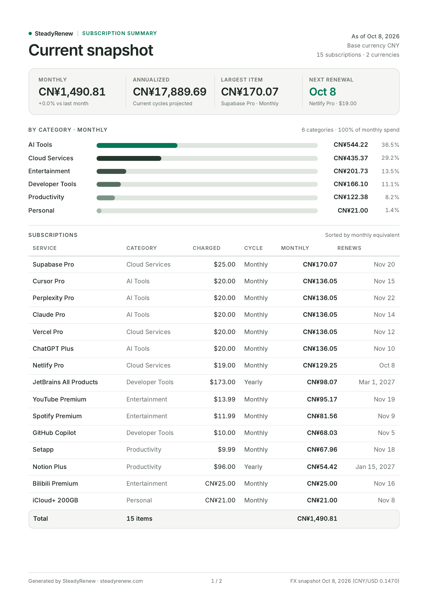
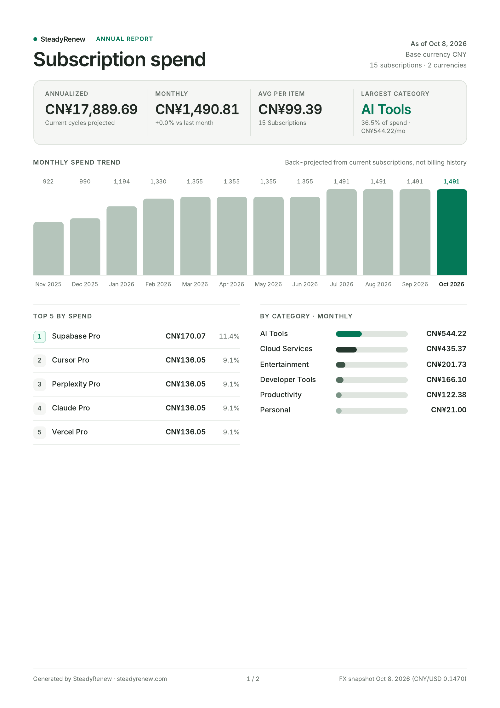

# SteadyRenew

[English](README.md) | [简体中文](README.zh-CN.md)

在线使用：[steadyrenew.com](https://steadyrenew.com) · 打开应用：[steadyrenew.com/app](https://steadyrenew.com/app) · 文档站：[steadyrenew.com/docs](https://steadyrenew.com/docs)

SteadyRenew 是一个本地优先的周期订阅与免费试用管理工具，无需绑定银行账户。支持多币种折算、Bark 推送提醒、AI 自然语言/截图录入、客户端 A4 PDF 报表导出、可选云同步，以及开放 API 与 MCP 助手接入。

应用无需注册账号即可使用，数据默认保存在浏览器本地。如需多设备云同步、Passkey 通行密钥登录、终身高级版支付、服务端定时推送或 API/MCP 自动化，可按需配置 Supabase、Stripe、Netlify Functions 与 Bark。

https://github.com/user-attachments/assets/a7bb1549-0076-4aa8-a8d8-4a6d5ba0e17c

<p align="center"><em>用 AI 助手一句话录入：说清要加的订阅，核对草稿，确认后写入。</em></p>

https://github.com/user-attachments/assets/08f934dc-0460-4085-a0ba-f2d5193de3d1

<p align="center"><em>手动录入订阅：填好表单，保存后即可在仪表盘看到新卡片。</em></p>

<p align="center">
  <a href="docs-site/images/product/pdf-report-snapshot.png"></a>
  <a href="docs-site/images/product/pdf-report-annual.png"></a>
</p>

<p align="center"><em>可打印的 A4 PDF 报表：当前快照与年度支出（示例数据，展示首页）。</em></p>

## 功能特性

- 记录周期订阅与一次性到期的免费试用（分类、金额、币种、计费周期与续费/试用到期日）
- 按所选基准货币查看月度和年度总支出
- 支持 CNY、USD、EUR、JPY、GBP、AUD、CAD、CHF、HKD 和 SGD 之间的换算
- 按名称、金额、续费日期、分类、状态或创建时间排序和筛选订阅
- 管理内置分类和自定义分类
- 使用 AI 录入从文本或截图中提议新增、修改、删除和批量更新
- 以 JSON 文件导入和导出订阅备份
- 查看支出报告、分类占比、最高支出订阅和续费分布
- 在浏览器本地直接导出可打印的 A4 PDF 报表（当前快照与年度报告）
- 可选启用 Supabase 登录（邮箱密码、OAuth、Passkey 通行密钥）和多设备云同步
- 可选通过 Bark 推送发送续费与免费试用到期提醒
- 支持通过远程托管 Streamable HTTP MCP（`/api/mcp`）、单文件本地 stdio MCP（`/downloads/steadyrenew-mcp.mjs`）或 `/api/v1/*` REST API 连接各类 AI 助手
- 支持桌面端和移动端的浅色/深色模式

## 技术栈

- React 18 & TypeScript
- Vite & Tailwind CSS
- i18next & Recharts
- Supabase（Auth、Postgres + RLS、WebAuthn Passkeys）
- Netlify Edge Functions & Serverless / Scheduled Functions
- Model Context Protocol（`@modelcontextprotocol/sdk`）
- Stripe Checkout & Webhooks

## 快速开始

### 环境要求

- Node.js 22.12 或更新版本
- npm

### 本地运行

```bash
git clone https://github.com/JerryyrreJ/subscription-management.git
cd subscription-management
npm install
npm run dev
```

Vite 开发服务器默认运行在 `http://localhost:5173`（访问 `/app` 进入订阅工作台）。

如需在本地联调 Netlify Functions（`/api/v1/*`、`/api/mcp`、AI 录入、Stripe 或定时提醒），请运行：

```bash
npm run dev:full
```

该命令需要安装 Netlify CLI。

## 常用脚本

```bash
npm run dev                 # 启动 Vite 前端开发服务器
npm run dev:full            # 启动 Netlify 本地完整开发环境（前端 + Functions）
npm run build               # 构建前端、Agent/MCP 交付物及预渲染页面
npm run preview             # 预览生产构建产物
npm run indexnow            # 将 sitemap URL 提交给 IndexNow
npm run lint                # 运行 ESLint 检查
npm run typecheck           # 运行前端、Functions 和构建脚本 TypeScript 检查
npm run test                # 运行工具函数与 SEO/博客测试
npm run test:functions      # 运行 Netlify Functions 与 Edge Functions 测试
npm run db:verify           # 重置、lint 并测试本地 Supabase 数据库迁移
npm run check               # 依次执行 typecheck、lint、测试和构建
npm run test:notifications  # 测试定时通知逻辑
```

## 配置概览

核心应用不需要环境变量。可选云服务使用以下环境变量（详见 `.env.example`）：

| 服务 | 变量 | 用途 |
| --- | --- | --- |
| 站点与入口地址 | `VITE_SITE_URL`, `VITE_APP_URL`, `VITE_DOCS_URL`, `SITE_URL` | 主站 canonical 域名、`/app` 入口、`/docs` 地址及服务端回调 URL |
| Supabase | `VITE_SUPABASE_URL`, `VITE_SUPABASE_ANON_KEY`, `SUPABASE_URL`, `SUPABASE_PUBLISHABLE_KEY`, `SUPABASE_SECRET_KEY`（兼容 `SUPABASE_SERVICE_ROLE_KEY`） | 登录、Passkey、云同步、定时提醒、API Key 与 AI 配额 |
| Stripe | `VITE_STRIPE_PUBLISHABLE_KEY`, `STRIPE_SECRET_KEY`, `STRIPE_WEBHOOK_SECRET`, `STRIPE_PRICE_ID`, `STRIPE_MODE`, `PRODUCTION_SUPABASE_URL` | \$9 买断终身高级版结账、测试/生产隔离校验与 Webhook 对账 |
| 开放 API 与 MCP | `API_RATE_LIMIT_PER_MINUTE`, `API_MAX_ACTIVE_KEYS`, `API_FAILED_AUTH_RATE_LIMIT_PER_HOUR`, `API_RATE_LIMIT_RETENTION_HOURS` | 可选覆盖 API/MCP 限额（默认每分钟 `60` 次、`5` 个有效 Key） |
| AI 录入 | `OPENROUTER_API_KEY`、`ANTHROPIC_API_KEY`、`AI_PROVIDER`、`AI_MODEL`、`AI_FALLBACK_MODELS`、`OPENROUTER_SITE_URL`、`OPENROUTER_APP_TITLE`、`AI_FREE_MONTHLY_PARSES`、`AI_PREMIUM_MONTHLY_PARSES`、`AI_MAX_INPUT_CHARS`、`AI_MAX_IMAGE_BYTES`、`AI_MONTHLY_BUDGET_USD`、`AI_INPUT_USD_PER_MTOK`、`AI_OUTPUT_USD_PER_MTOK` | 可选的 AI 辅助录入；不设供应商 Key 即禁用 |
| Bark | 在应用内 **设置 → 通知** 配置 | 订阅续费与免费试用推送提醒 |
| Netlify | `URL`（Netlify 自动注入）、`MINTLIFY_UPSTREAM_ORIGIN` | 函数回调地址回退与 `/docs` 代理上游覆盖 |

## AI 录入与隐私

AI 录入可以从一句话、一段账单文本或一张截图开始，提议新增、修改、删除和批量更新订阅，再由你核对确认后执行——AI 只负责「提议」，绝不直接写入你的数据。

- **可选、可替换。** 设置 `OPENROUTER_API_KEY` 即启用低成本 OpenRouter 路径（默认 `google/gemini-2.5-flash-lite`，备选 `google/gemini-2.5-flash`）；也可通过 `AI_PROVIDER=anthropic` + `ANTHROPIC_API_KEY` 使用 Anthropic。不设置供应商 Key 时自动回退到手动表单。
- **用量与成本控制。** 已登录用户按**月度**计算解析配额（Free 每月 **10** 次、终身高级版每月 **300** 次，仅成功解析计次），单次请求限制输入大小，并设有工作区级月度预算熔断机制；供应商密钥仅保存在服务端。
- **隐私保护。** 你粘贴或上传的内容只为本次识别发送给模型供应商一次，**不存储、不记录**——服务端只保留工作区聚合 token 计数和每用户**每月**成功次数，绝不保存原始内容。截图在浏览器端先降采样再上传。

## 文档导航

中英双语公开文档统一维护在 [`docs-site/`](docs-site/README.md)（线上地址 [steadyrenew.com/docs](https://steadyrenew.com/docs)）：

- [Mintlify 文档站说明](docs-site/README.md) 与 [文档目录索引](docs/README.md)
- [快速开始](docs-site/zh-CN/getting-started.mdx) · [配置说明](docs-site/zh-CN/configuration.mdx) · [部署说明](docs-site/zh-CN/deployment.mdx)
- [Supabase 云同步与 Passkey](docs-site/zh-CN/integrations/supabase.mdx)
- [使用 Bark 续费提醒](docs-site/zh-CN/integrations/notifications.mdx)
- [使用 Stripe 支付](docs-site/zh-CN/integrations/payments.mdx)
- [AI 录入](docs-site/zh-CN/integrations/ai-capture.mdx)
- [开放 API 概览](docs-site/zh-CN/api/overview.mdx) 与 [连接 Agent（MCP 与 API）](docs-site/zh-CN/user-guide/agent-setup.mdx)
- [公开指南（`/blog`）写作说明](dev-docs/blog.zh-CN.md)
- [运维操作手册](docs/operations/) 与 [更新日志](CHANGELOG.md)

## 项目结构

```text
src/                      React 应用与公开页面代码（/app、首页、定价页、法律页）
content/blog/             公开 SEO 指南源文件（静态构建至 /blog 与 /zh/blog）
scripts/                  预渲染、博客生成、Agent/MCP 产物打包与巡检脚本
mcp/                      独立本地 stdio MCP 服务器源码与集成测试
netlify/edge-functions/   Edge 智能入口分流（smart-entry.ts）与 /docs 文档代理（docs-proxy.ts）
netlify/functions/        Serverless 与定时函数（/api/v1/*、/api/mcp、AI、Stripe、Bark）
supabase/                 时间戳 SQL 迁移、pgTAP 测试与本地配置
tests/                    Node 测试套件（工具、Functions、云同步与 Playwright 支付测试）
docs-site/                Mintlify 双语公开文档站源码及 OpenAPI / AI 工具规范
docs/                     文档索引、/agent/setup.md 源文件与运维手册
dev-docs/                 内部维护指南与历史归档设计草稿
```

## 产品首页

主域名承载预渲染产品落地页，应用位于同域 `/app`（生产环境为 `https://steadyrenew.com/app`）。可通过 `VITE_SITE_URL` 与 `VITE_APP_URL` 自定义主域名与应用入口，详见 [Landing page 与域名配置](dev-docs/landing-page.zh-CN.md)及[域名迁移记录](docs/operations/steadyrenew-domain-migration.md)。

## 搜索引擎

Bing Webmaster 通过 `public/BingSiteAuth.xml`（`/BingSiteAuth.xml`）及 `index.html` 中的 `msvalidate.01` meta 标签验证。IndexNow 使用 `public/16274743d7549a346d2cf33abbd2d73d.txt`，生产部署成功后运行 `npm run indexnow` 自动提交主站与文档站 sitemap URL（提交失败不阻断发布）。

## 公开指南

`/blog` 是主站上的静态内容中心（`https://steadyrenew.com/blog`），中文指南位于 `/zh/blog`。在 `content/blog/` 新增 Markdown 即可发布，详见[公开指南写作说明](dev-docs/blog.zh-CN.md)。

## 许可证

本项目使用 MIT License。详情见 [LICENSE](LICENSE)。
